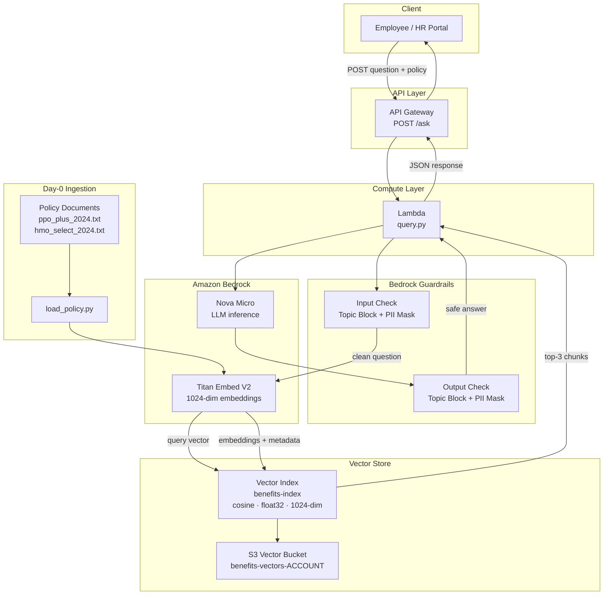
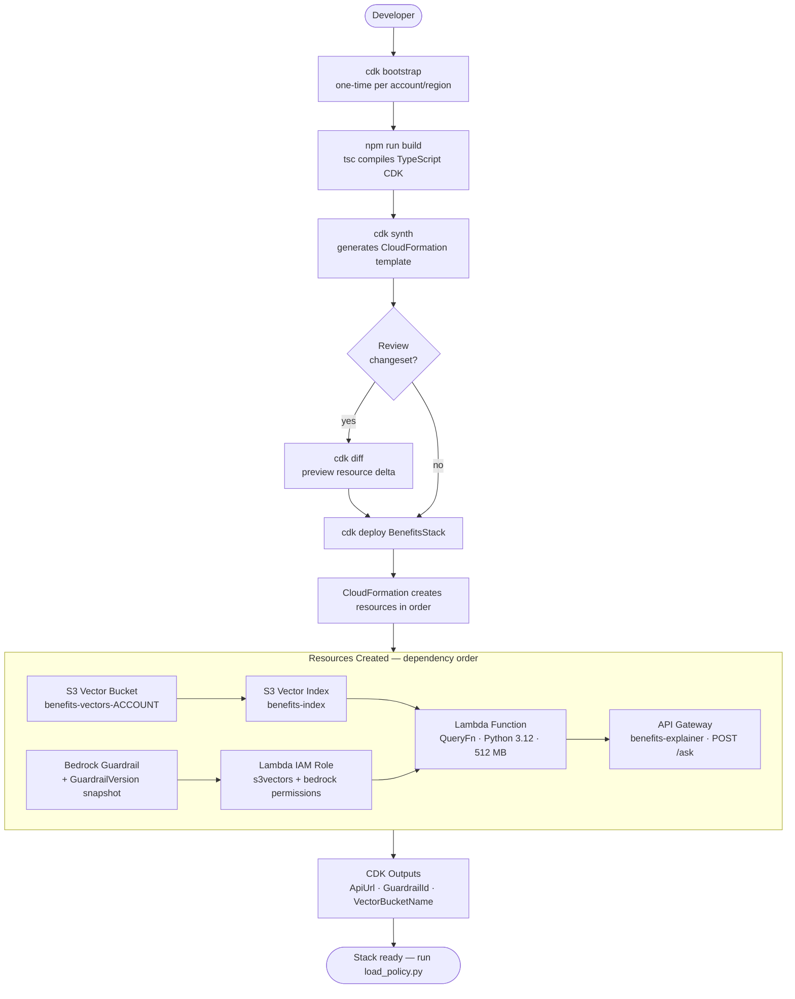
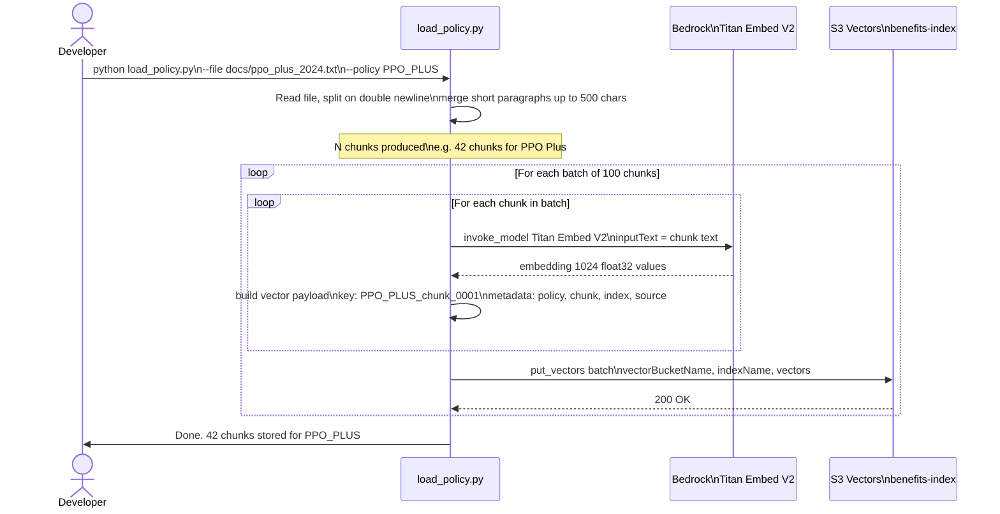
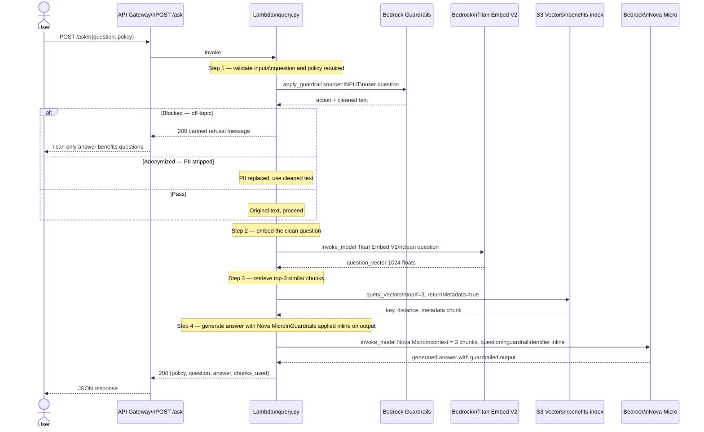
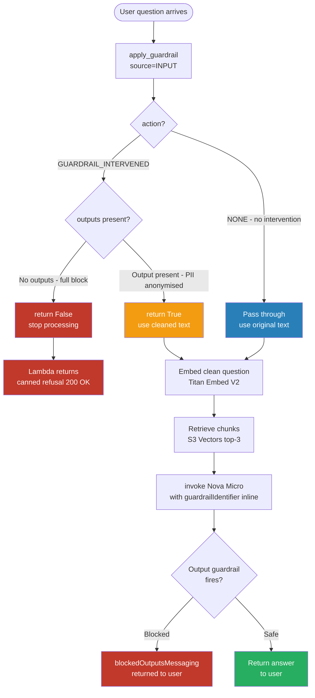
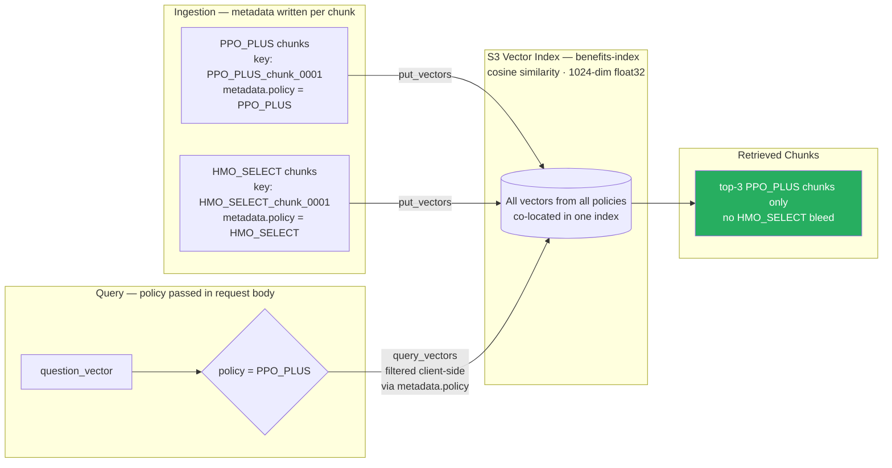
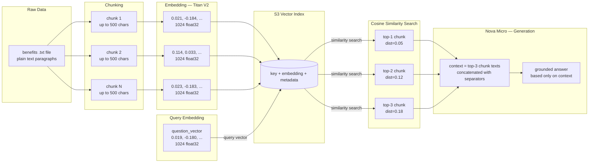
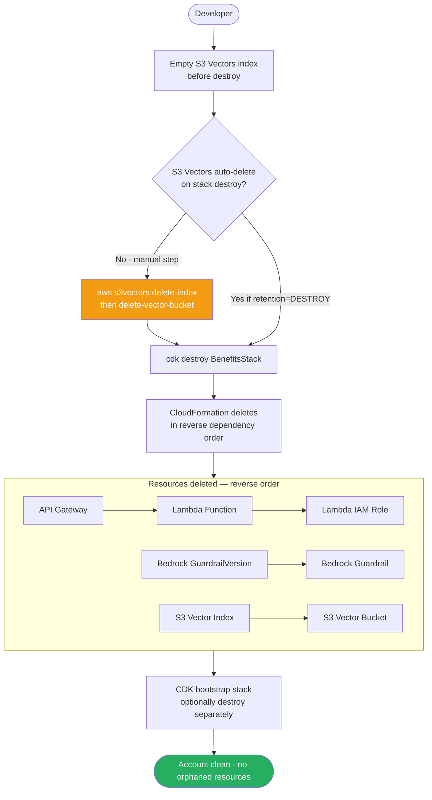

# Benefits Q&A — Amazon Bedrock + AWS CDK

A production-ready RAG (Retrieval-Augmented Generation) system that lets employees ask natural-language questions about their health insurance benefits plans and receive grounded, policy-specific answers — deployed entirely through reusable AWS CDK infrastructure.

---

## Business Use Case

HR and benefits teams maintain dense, plan-specific documents (PPO, HMO, dental, vision) that employees rarely read and constantly misunderstand. Every open-enrollment season and life event generates a wave of repetitive support tickets: *"Does my plan cover urgent care?"*, *"What is my deductible for out-of-network?"*, *"Is my spouse covered under HMO Select?"*

This system replaces that support burden with a self-service Q&A assistant that:

- Answers **only** health-benefits questions — any off-topic query is blocked at the guardrail layer before it reaches the LLM.
- Stays **grounded in the actual policy text** — the LLM never generates from general knowledge; it reasons only over retrieved chunks from the uploaded plan document.
- Filters answers **per plan** — an employee on PPO Plus only gets answers from PPO Plus chunks; HMO Select is a separate embedding namespace.
- **Masks PII automatically** — names, SSNs, phone numbers, and addresses in any question are anonymised before they touch the model.
- Is **fully managed** — no vector database to provision, no GPU cluster to maintain; S3 Vectors, Bedrock, and Lambda handle everything.

### Supported Plans (out of the box)

| Plan key | Document |
|---|---|
| `PPO_PLUS` | `docs/ppo_plus_2024.txt` |
| `HMO_SELECT` | `docs/hmo_select_2024.txt` |

---

## Stack

| Layer | Service | Purpose |
|---|---|---|
| IaC | AWS CDK (TypeScript) | Declare and deploy all infrastructure as code |
| Vector store | Amazon S3 Vectors | Serverless vector index — no extra infra |
| Embedding model | Amazon Titan Embed V2 | 1024-dim embeddings, consistent at ingest and query time |
| LLM | Amazon Nova Micro | Fast, low-cost inference for benefits Q&A |
| Safety | Amazon Bedrock Guardrails | Topic block + PII anonymisation on input and output |
| Compute | AWS Lambda (Python 3.12) | Stateless query handler wired to Bedrock and S3 Vectors |
| API | Amazon API Gateway | Public HTTPS endpoint: `POST /ask` |
| Ingestion | Python script (`load_policy.py`) | One-time day-0 document loader |

---

## Diagrams

### 1. System Architecture



---

### 2. Infrastructure Deployment Flow



---

### 3. Document Ingestion Flow



---

### 4. Query-time RAG Flow



---

### 5. Guardrails Decision Flow



---

### 6. Policy Filtering Flow



---

### 7. End-to-End Data Flow



---

### 8. Teardown Flow



---

## Quick Start

### Prerequisites

- AWS account with Bedrock model access enabled for `amazon.titan-embed-text-v2:0` and `amazon.nova-micro-v1:0`
- Node.js 18+ and Python 3.12+
- AWS CDK CLI: `npm install -g aws-cdk`

### Deploy

```bash
# 1. Install CDK dependencies
npm install

# 2. Bootstrap CDK (once per account/region)
cdk bootstrap

# 3. Build TypeScript
npm run build

# 4. Deploy
cdk deploy BenefitsStack
```

### Ingest Policy Documents

```bash
# Copy and fill in your AWS account details
cp .env.example .env

# Activate the Python virtual environment
source .venv/bin/activate

# Ingest both plans
python scripts/load_policy.py --file docs/ppo_plus_2024.txt  --policy PPO_PLUS
python scripts/load_policy.py --file docs/hmo_select_2024.txt --policy HMO_SELECT
```

### Query

```bash
# Replace API_URL with the ApiUrl value from CDK outputs
curl -s -X POST $API_URL/ask \
  -H "Content-Type: application/json" \
  -d '{"question": "What is my annual deductible?", "policy": "PPO_PLUS"}' | jq
```

Expected response:

```json
{
  "policy": "PPO_PLUS",
  "question": "What is my annual deductible?",
  "answer": "Your PPO Plus annual deductible is ...",
  "chunks_used": 3
}
```

### Teardown

```bash
cdk destroy BenefitsStack
```


---

## Project Structure

```
ts-benefits-cdk/
├── app.ts                      # CDK app entry point
├── stacks/
│   └── benefitsStack.ts        # All infrastructure — S3 Vectors, Guardrails, Lambda, API GW
├── lambda/
│   └── query/
│       └── query.py            # RAG handler: guardrail → embed → retrieve → generate
├── scripts/
│   └── load_policy.py          # Day-0 ingestion: chunk → embed → put_vectors
├── docs/
│   ├── ppo_plus_2024.txt       # PPO Plus benefits document
│   └── hmo_select_2024.txt     # HMO Select benefits document
├── .env.example                # Environment variable template
└── cdk.json                    # CDK app configuration
```

---

## Guardrail Policy

| Rule | Configuration |
|---|---|
| Blocked topics | Anything not about health insurance benefits (finance, medical diagnosis, legal, coding, general knowledge) |
| PII anonymised | `NAME`, `EMAIL`, `PHONE`, `ADDRESS`, `US_SOCIAL_SECURITY_NUMBER`, `CREDIT_DEBIT_CARD_NUMBER` |
| Blocked input message | `"I can only answer questions about your health insurance benefits plan."` |
| Blocked output message | `"I was unable to generate a safe response. Please rephrase your question."` |
| Applied at | Input via explicit `apply_guardrail` call and output via inline `guardrailIdentifier` on `invoke_model` |
